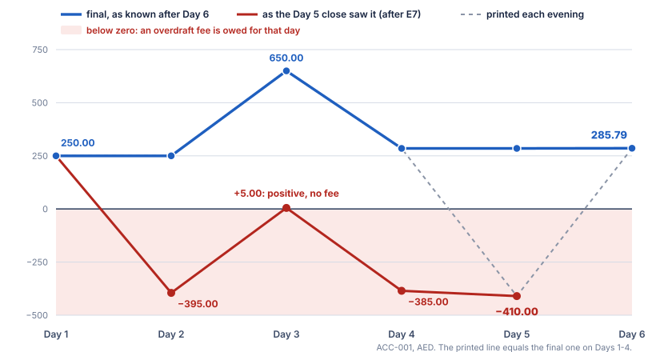
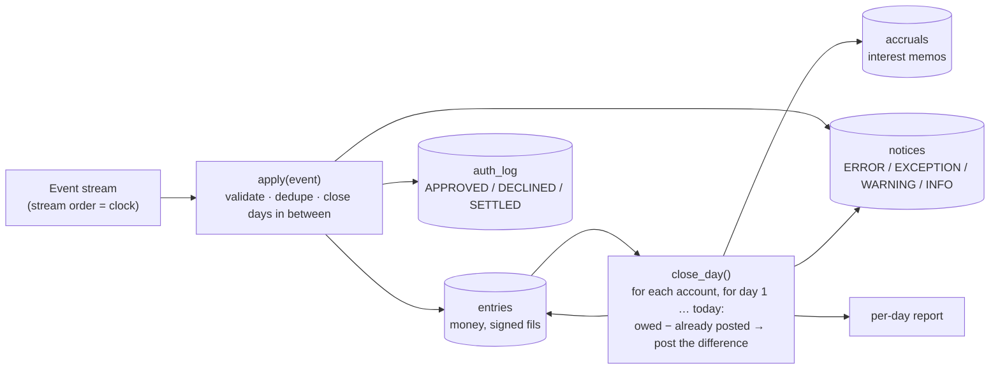
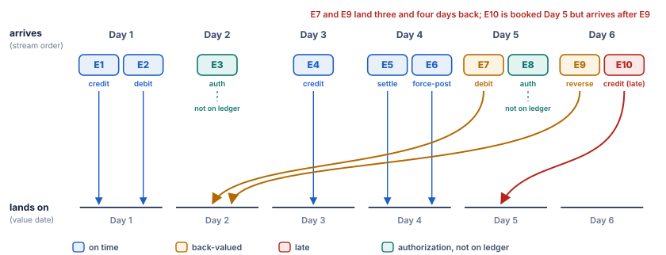
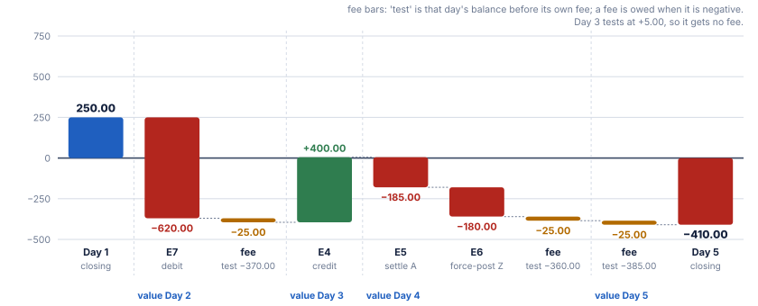
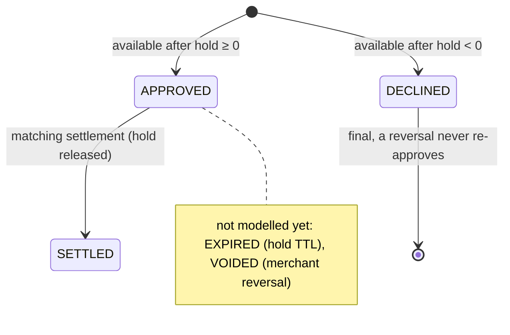

# In-Memory Account Ledger Core

[](https://github.com/gholinejad/ledger-core/actions/workflows/ci.yml)


This is an append-only ledger that replays a six-day event stream of credits, debits, card holds, settlements, a back-valued debit, its reversal and a late instalment credit. For each day it prints the closing balance, fees, authorization states and errors.

The whole design comes down to one idea: **the past is never edited.** Every end-of-day close re-evaluates every day as it is now known, and posts only the difference as new records.

<p align="center"></p>

## Results at a glance

| | ACC-001 (AED) | ACC-002 (BHD) |
|---|---|---|
| **Day 5 close** | **−410.00**: E7 lands on Day 2 and three overdraft fees follow (value Days 2, 4 and 5) | 0.000: E10 has not arrived yet |
| **Day 6 close** | **285.79**: E9 reverses E7, the three fees are refunded, 0.79 interest is capitalised | **10.008**: three instalments of 3.333 + 3.333 + 3.334, plus 0.008 interest |
| **Authorizations** | Auth-A: APPROVED on Day 2, SETTLED at 185.00 on Day 4. Auth-B: **DECLINED** on Day 5, because available would be −425.00. Auth-Z: no authorization, so it is force-posted and raised as an exception | |
| **Acceptance criteria** | Accepted: **1, 3, 5**. Rejected: **2** (one fee), **4** (reject unmatched settlement), **6** (everything returns after E9), **7** (3.334 instalments), **8** (discard the remainder). Reasons in [REJECTED.md](REJECTED.md) | |

Every figure is derived by hand in [NUMBERS.md](NUMBERS.md). The tests assert the fee days, the final balances of both accounts, Auth-B's decline and every criterion.

## Run it

```bash
python3 replay.py                          # the per-day report
python3 -m unittest tests.test_ledger -v   # 27 tests, all pass
python3 -m unittest tests.test_known_failure   # the one test that fails on purpose
```

It needs Python 3.10 or later and the standard library only. CI runs all three on every pull request.

## How it works



1. **Money is integer minor units** (fils). Every stored amount is an integer, so additions are exact. Decimal is used to parse and print amounts and to apply the interest rate; the one rounding, half-even, happens there.
2. **Three append-only state logs**, holding frozen records, plus an append-only `notices` log for operations:
   - `entries`, the ledger;
   - `accruals`, the interest memos;
   - `auth_log`, the authorization transitions.

   A state is always the latest record. A correction is a new record.
3. **Holds are not ledger entries.** Available balance = ledger balance − holds of APPROVED authorizations.
4. **The close re-evaluates every day of the window, oldest first.** For each day it works out the fee and accrual owed under what is known now, and posts only the difference: `FEE`, `FEE_REVERSAL` or an accrual delta. That makes back-valued entries safe and the restatement idempotent.
5. **Stream order is processing order.** A late event (E10) is processed on the day it arrives, flagged, and posted with its own value date. That restates the earlier day; the order in which events are processed is never changed.

### Arrival day vs. the day an event lands on

The difficulty is in the value dates. E7 and E9 arrive on Days 5 and 6 but land on Day 2, and E10 arrives after a Day 6 event:

<p align="center"></p>

### Day 5: one back-valued debit, three fees

E7 does not change one day. It lowers every day from Day 2 onward, and each of those days must be tested again. Day 3 stays positive at +5.00, so it is not charged a fee:

<p align="center"></p>

### Authorization lifecycle



A settlement with no APPROVED authorization behind it, such as Auth-Z, is **force-posted** and raised as an `EXCEPTION` for chargeback review. Refusing it would not stop the money leaving the bank. See [REJECTED.md, criterion 4](REJECTED.md).

## Reading the output

Each `=== Day N close ===` block is what the ledger printed when it closed day N, using only what it knew at that point. This is the Day 5 block:

```text
=== Day 5 close ==================================================
ACC-001  closing ledger      -410.00 AED   available      -410.00 AED   holds 0.00 AED
    restated  Day 2 closing 250.00 AED -> -395.00 AED
    restated  Day 3 closing 650.00 AED -> 5.00 AED
    restated  Day 4 closing 285.00 AED -> -385.00 AED
    fee assessed  25.00 AED value Day 2
    fee assessed  25.00 AED value Day 4
    fee assessed  25.00 AED value Day 5
    accrual   Day 2 -0.10 AED
    accrual   Day 3 -0.26 AED
    accrual   Day 4 -0.11 AED
ACC-002  closing ledger        0.000 BHD   available        0.000 BHD   holds 0.000 BHD
  authorizations:
    Auth-A  SETTLED   (E5: settled 185.00 AED; hold 200.00 AED released (15.00 AED never charged))
    Auth-B  DECLINED  (E8: available after hold would be -425.00 AED)
  errors and exceptions:
    none
  note: E7 back-valued to Day 2
```

| Line | Meaning |
|---|---|
| `closing ledger` | Sum of all entries with value date ≤ N. Holds are excluded. On Day 6 it includes the capitalised interest. |
| `available` | Ledger balance minus active holds. |
| `restated Day k closing X -> Y` | An entry dated to an earlier day has changed day k since it was last printed. Nothing is edited. |
| `fee assessed / fee reversed` | A `FEE` or `FEE_REVERSAL` entry posted by this close, with the day it belongs to. |
| `accrual Day k ±x` | An interest memo, or a correction to one. It is capitalised at the end of Day 6. |
| `authorizations` | Every authorization's current state, the event that set it, and why. |
| `errors and exceptions` | `ERROR`: refused, nothing posted. `EXCEPTION`: posted, needs ops review. `WARNING`: unusual. |
| `note` | Informational, for example "back-valued to Day 2". |

## The documents

| File | What it answers |
|---|---|
| [NUMBERS.md](NUMBERS.md) | Every constant, and why that value and not half of it. Every printed figure, derived by hand. |
| [AMBIGUITIES.md](AMBIGUITIES.md) | Every place the brief allows two readings, which one I chose, and what the other would change. |
| [REJECTED.md](REJECTED.md) | The five criteria I refused, with tests. Approaches abandoned or not built. |
| [docs/architecture.pdf](docs/architecture.pdf) | Scale, value dates in a UAE-licensed bank, the authorization lifecycle, what I cut. |
| [tests/test_known_failure.py](tests/test_known_failure.py) | The one failing test. It shows that the Day 5 statement for ACC-002 went out without E10. |
| [WORKLOG.md](WORKLOG.md) | What happened when, append-only. |
| [CONTRIBUTING.md](CONTRIBUTING.md) | How changes land: protected `main`, one PR per concern, CI plus one independent agent review. |

## Repository layout

```text
ledger/money.py        minor units, half-even rate rounding, remainder-to-last split
ledger/core.py         the ledger: event handlers, end-of-day close, restatement
ledger/stream.py       the two accounts and the ten events, in replay order
replay.py              runs the stream and prints the per-day report
tests/test_ledger.py   every criterion tested for or against, invariants, edge cases (27 tests)
tools/make_figures.py  draws docs/img/*.svg: README charts replay the ledger; architecture figures are diagrams
```

## How changes are made

`main` is protected, including against admins. Every change arrives as a pull request with one concern. It merges only when two checks are green on its head commit:
- **`tests`**: CI;
- **`agent-review`**: one review by an agent that did not write the change. It follows [.claude/skills/agent-pr-review](.claude/skills/agent-pr-review/SKILL.md).

Only merge commits are allowed, so the history is never squashed. See [CONTRIBUTING.md](CONTRIBUTING.md).
